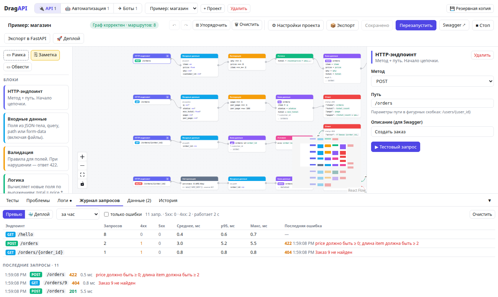
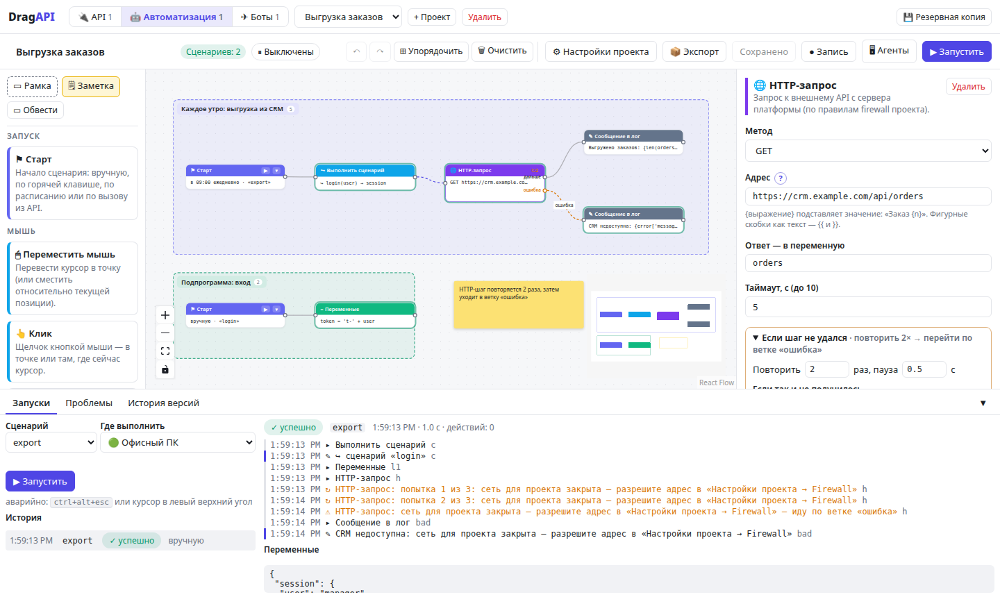
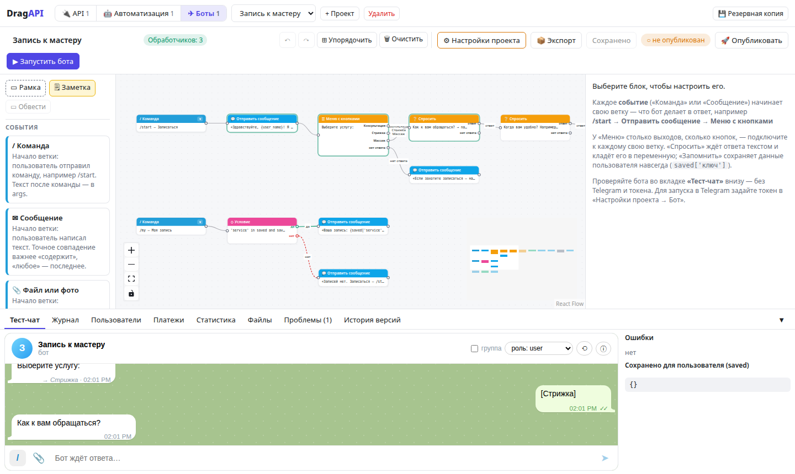

# DragAPI

**No-code платформа: HTTP API, автоматизация компьютера и Telegram-боты собираются из блоков на холсте.**

Перетаскиваете блоки, соединяете их в цепочку — и это сразу работает: API отвечает на запросы и
показывает Swagger, сценарий двигает мышь и жмёт клавиши, бот отвечает в тест-чате. Готовый API
выгружается обычным FastAPI-приложением с Dockerfile — без зависимости от платформы.



## Что умеет

**🔌 API**
- Эндпоинты, входные данные, валидация, логика, авторизация (API-ключ, Bearer), условия, ответы
- Модели данных со связями и миграциями; база — встроенная SQLite или **PostgreSQL** (в том числе
  подключение к уже существующей базе с импортом моделей из таблиц)
- Блок «Python-код» в песочнице, pip-библиотеки проекта, firewall для исходящих и входящих запросов
- Тестовые запросы с пошаговой трассой по блокам, тест-кейсы, экспорт тестов в pytest
- **Журнал запросов**: число запросов, ошибки, время ответа (p95) по каждому эндпоинту
- Экспорт в FastAPI и деплой в Docker одной кнопкой

**🤖 Автоматизация**
- Мышь, клавиатура, автокликер, запись действий в блоки, горячие клавиши, расписание, вебхуки
- Компьютерное зрение: поиск картинки на экране, цвет пикселя, распознавание текста (OCR), работа с окнами
- Повтор шага при неудаче и ветка «ошибка», подпрограммы, Telegram-уведомления
- Удалённые агенты: сценарии выполняются на других компьютерах



**✈ Telegram-боты**
- Команды, меню с кнопками, вопросы и анкеты, роли, файлы, оплата Telegram Stars, модерация групп
- Отложенные сообщения и рассылки, статистика, выгрузка в Excel
- Тест-чат прямо в редакторе — без Telegram и токена; черновик и публикация; готовые шаблоны
- Бот выгружается отдельной программой



**Платформа**
- Рамки и заметки на холсте, отмена (Ctrl+Z), копирование блоков между проектами
- Пользователи и роли, история версий, экспорт и импорт проектов файлом
- Резервная копия всех данных одной кнопкой (с шифрованием паролем)
- HTTPS (свой сертификат, самоподписанный или через Caddy / nginx) и запуск службой на сервере

## Быстрый старт

Нужны **Python 3.10+** и **Node.js 18+**. Скрипт сам поставит зависимости, соберёт интерфейс и запустит
платформу на http://localhost:8765.

**Linux / macOS**
```bash
git clone https://github.com/<вы>/DragAPI.git
cd DragAPI
./start.sh
```

**Windows** — двойной щелчок по `start.cmd` или в PowerShell:
```powershell
git clone https://github.com/<вы>/DragAPI.git
cd DragAPI
.\start.ps1
```

При первом входе платформа предложит создать администратора. Для быстрой пробы на своём компьютере
можно без входа: `./start.sh --no-auth` (работает только на 127.0.0.1 и только пока нет пользователей).

Режим разработки (интерфейс обновляется на лету): `./start.sh dev` → http://localhost:5173.

## Поддержка ОС

| | Linux | macOS | Windows |
|---|:-:|:-:|:-:|
| API, боты, экспорт, деплой в Docker | ✓ | ✓ | ✓ |
| Автоматизация (мышь, клавиатура, зрение) | ✓ X11 | ✓ | ✓ |
| Блоки окон | ✓ X11 | — | ✓ |
| Строгая песочница кода без Docker (firejail) | ✓ | — | — |

На macOS агенту автоматизации нужны разрешения «Универсальный доступ», «Мониторинг ввода» и
«Запись экрана». Подробности — в [руководстве](docs/GUIDE.md#различия-между-ос).

## Документация

- [Подробное руководство](docs/GUIDE.md) — все блоки, настройки, API платформы, безопасность
- [Запуск на сервере и HTTPS](deploy/README.md) — Caddy, nginx, systemd, самоподписанный сертификат

## Как устроено

- **Бэкенд** — Python, FastAPI, SQLAlchemy (`backend/`). Превью проектов монтируются в сам сервер, экспорт
  генерирует самостоятельный `main.py`.
- **Интерфейс** — React и React Flow (`frontend/`).
- **Агент автоматизации** — `backend/dragapi_agent/`, работает и отдельно на другом компьютере.
- **Тесты** — `cd backend && .venv/bin/python -m pytest -q`; в GitHub Actions на Linux, macOS и Windows.

Все данные хранятся в `backend/data/` (в git не попадают). Ключ шифрования секретов —
`backend/data/secret.key`: делайте резервные копии.
